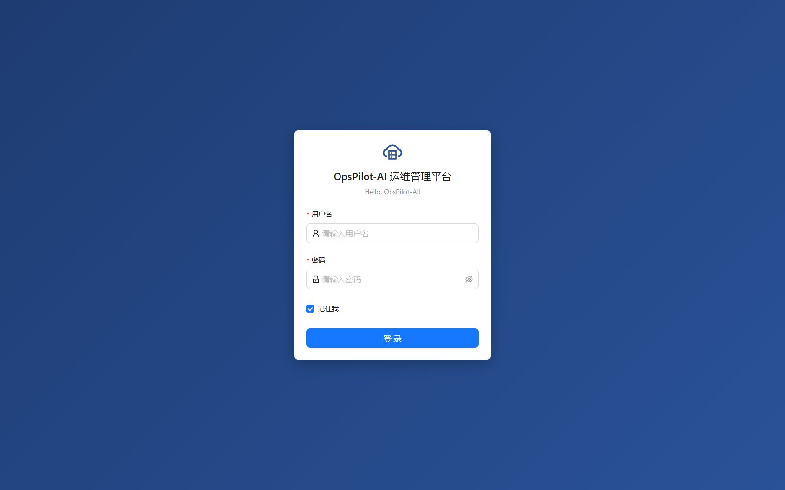
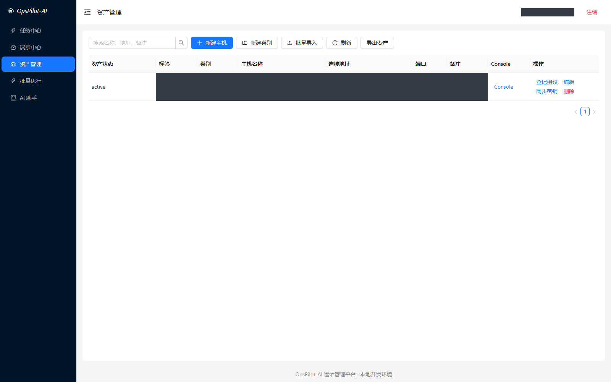
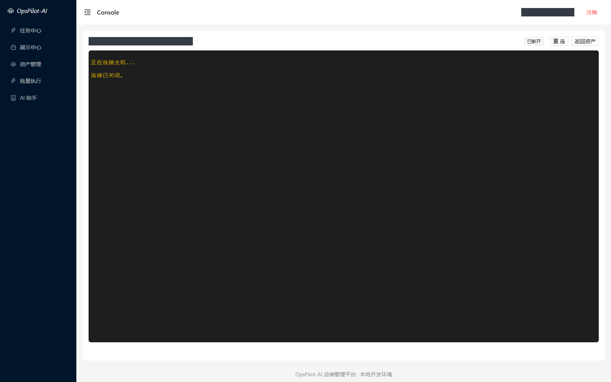
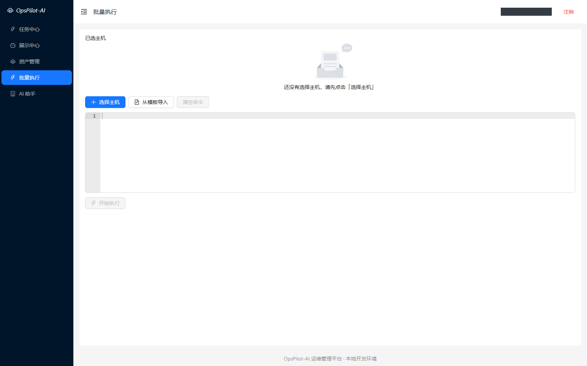
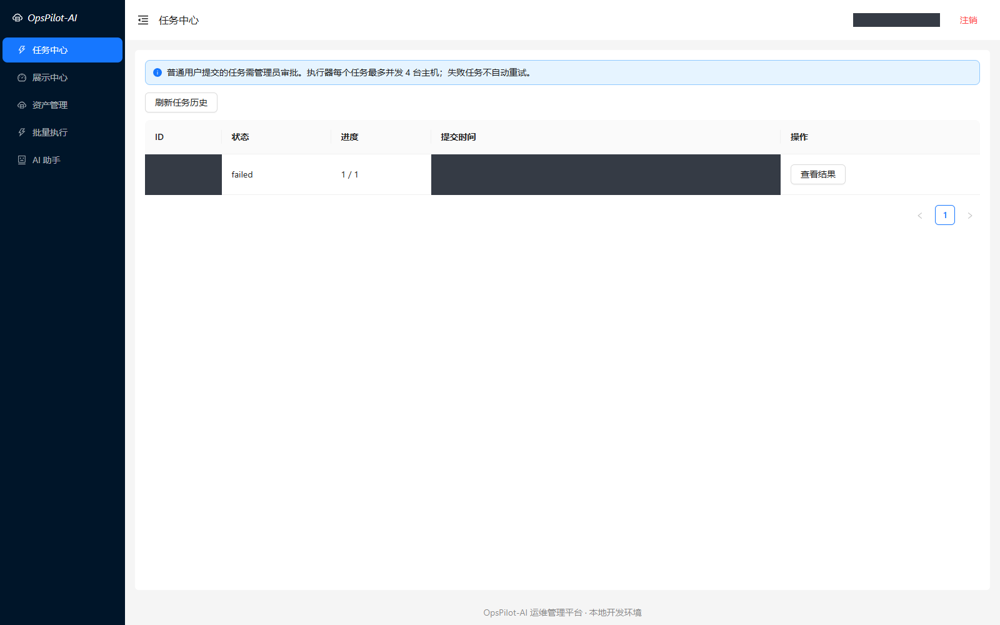
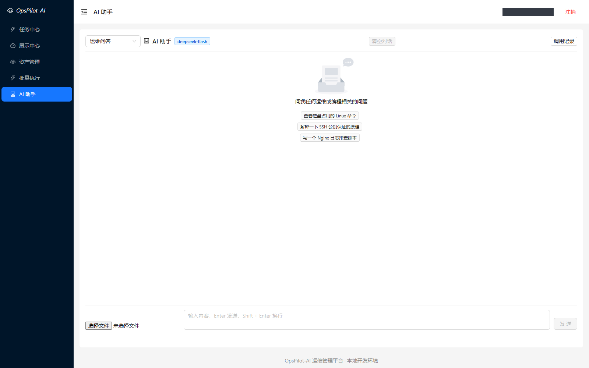

# OpsPilot-AI 运维管理平台

面向 Linux 服务器和中小规模运维场景的管理平台，提供资产管理、Web SSH、批量任务审批与执行，以及 AI 运维问答、日志分析和故障诊断辅助能力。

项目用于技术学习、授权资产管理和作品展示。AI 只提供分析建议，没有服务器执行权限。

## 技术栈

- 后端：Python 3.12、Django 5.2、Django REST Framework、Channels 4、Daphne、Paramiko、JWT。
- 前端：Vue 3、Vue Router、Vuex、Ant Design Vue、xterm.js、ECharts、Ace Editor。
- 数据：本地 SQLite，任务和调用记录持久化。
- AI：后端封装 DeepSeek API，密钥不进入浏览器。

## 当前功能

| 模块 | 已有能力 |
| --- | --- |
| 用户认证 | JWT 登录、用户资料、接口鉴权与前端路由认证 |
| 主机资产 | 分类、搜索、分页、编辑、标签、人工状态、Excel 导入、CSV 导出和主机授权 |
| Web SSH | 严格服务器指纹校验、管理员登记可信公钥、登录公钥同步、终端转发、断线重连和会话记录 |
| 批量任务 | 普通用户任务审批、后台执行、最多 4 台并发、超时与失败隔离、执行进度和历史结果 |
| AI 运维 | 问答、日志分析、故障诊断、日志文件输入、常见凭据脱敏、限流和 Token 用量记录 |

## 页面展示

以下为本地实际页面截图。用户名、主机名称、IP、端口、分类、标签、备注和任务标识等敏感区域已使用实色遮挡。终端截图只展示界面，没有建立 SSH 连接；截图过程中没有执行远程命令或调用付费 AI。

### 登录



### 主机资产



### Web SSH 终端



### 批量执行



### 任务中心



### AI 助手



## 项目结构

```text
opspilot_api/
  opspilot_api/
    apps/host/       # 主机资产、授权、指纹登记与终端
    apps/mtask/      # 指令模板、任务审批与执行器
    apps/users/      # 用户与 JWT
    apps/ai/         # DeepSeek 分析与调用记录
    settings/        # 本地与生产配置
opspilot_web/src/    # 前端页面、路由、状态与 API 客户端
scripts/             # 本地启动、停止和 HTTP 冒烟检查
```

原 uric_api / uric_web 已更名为 opspilot_api / opspilot_web。数据库表名保持不变以兼容已有数据，旧 /uric 页面地址与登录存储可兼容迁移。

## 本地运行

项目根目录安装依赖：

```powershell
python -m venv .venv
.\.venv\Scripts\python.exe -m pip install -r requirements.txt
cd opspilot_web
pnpm install --frozen-lockfile
cd ..
```

首次初始化管理员：

```powershell
cd opspilot_api
$env:DJANGO_SETTINGS_MODULE='opspilot_api.settings.local'
..\.venv\Scripts\python.exe manage.py migrate
..\.venv\Scripts\python.exe manage.py createsuperuser
cd ..
```

启动前后端及单实例任务执行器：

```powershell
.\scripts\start-local.ps1
```

页面：http://127.0.0.1:9000；后台授权管理：http://127.0.0.1:8000/admin/。
停止使用 `.\scripts\stop-local.ps1`。
首次连接主机应先从可信渠道取得服务器公钥，核对指纹并登记，再同步用户登录公钥。仅录入本地资产不会连接服务器。

更多步骤见 [本地测试说明](docs/LOCAL_TESTING.md)。

## 环境配置

敏感配置通过环境变量或未跟踪的 opspilot_api/opspilot_api/settings/local_secret.py 提供。

| 变量 | 用途 |
| --- | --- |
| DJANGO_SETTINGS_MODULE | 本地使用 opspilot_api.settings.local |
| DJANGO_SECRET_KEY | 固定本地签名密钥；未设置时重启后需要重新登录 |
| SSH_KNOWN_HOSTS | 可信服务器公钥文件；本地默认 opspilot_api/known_hosts |
| SSH_KEY_ENCRYPTION_KEY | SSH 私钥加密密钥，Fernet 格式 |
| DEEPSEEK_API_KEY | 仅供后端使用的 API 密钥 |
| DEEPSEEK_MODEL | 按账户实际可用情况配置模型 |

数据库、虚拟环境、日志、known_hosts 和私有配置不进入版本库。

## 验证与限制

本地 20 项后端测试通过，迁移检查没有遗漏。前端构建通过，存在资源包体积警告；HTTP 冒烟检查覆盖登录、鉴权、资产管理、导出及历史查询。

```powershell
cd opspilot_api
$env:DJANGO_SETTINGS_MODULE='opspilot_api.settings.local'
..\.venv\Scripts\python.exe manage.py test host mtask ai
```

真实 SSH 成功连接与 DeepSeek 分析效果需要在授权测试环境单独验证。当前为单 API、单 worker 设计；完整终端回放、独立主机凭据、AI 费用预算和实时监控告警仍待完善。

本次发布不包含容器部署草案。历史提交中的旧凭据仍需核查和处置，当前源码清理不代表旧凭据已经轮换。
