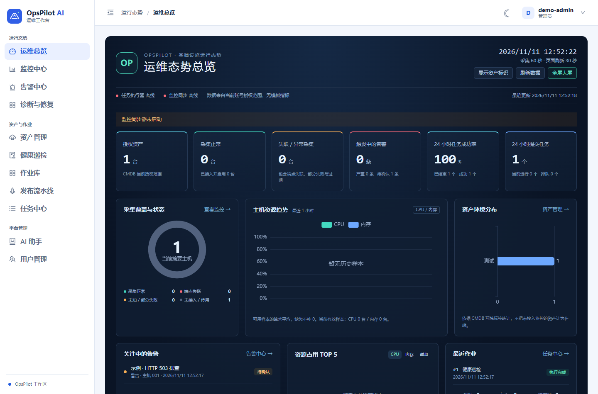
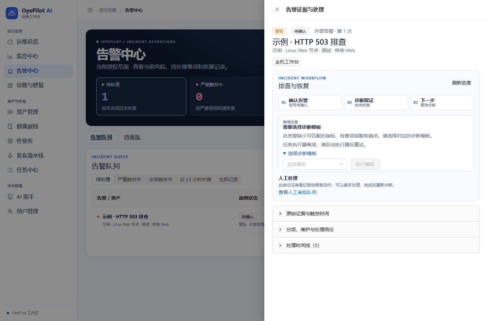
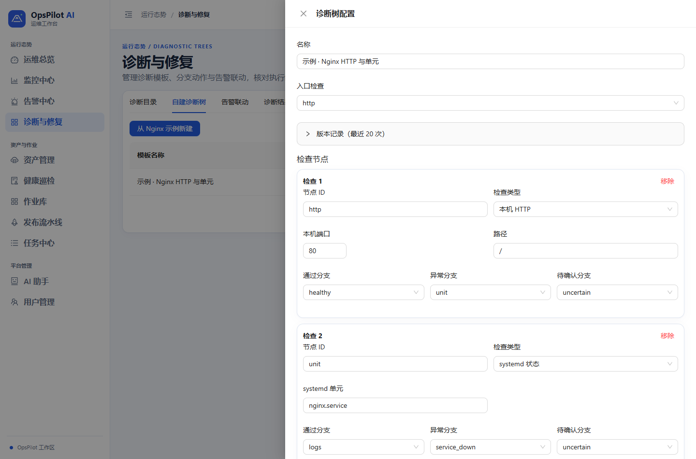

# OpsPilot-AI 运维管理平台

面向 Linux 服务器和中小规模运维场景的管理平台，提供资产管理、Web SSH、批量任务审批与执行，以及 AI 运维问答、日志分析和故障诊断辅助能力。

项目用于技术学习、授权资产管理和作品展示。AI 只提供分析建议，没有服务器执行权限。

发布流水线、诊断树与自愈配置见 [发布、诊断和自愈](docs/RELEASES_AND_RECOVERY.md)。
## 用户管理与 AI 模型

- 管理员从「平台管理 → 用户管理」创建、停用和授权账号，查看变更审计。运维员可对授权主机执行操作，观察员可查看授权范围内的资产与监控数据。创建、权限变更、停用和密码重置的审计记录不含密码。
- 新账号的主机授权为空。管理员可维护资产及 SSH 连接信息；运维员和观察员依赖明确授权。更改角色、主机范围或停用账号会撤销旧令牌；活跃 Web SSH 会话会周期性复核权限。
- AI 助手默认沿用服务端的 DeepSeek 配置。也可在「模型设置」中输入个人 DeepSeek 或 OpenAI API Key，查询模型 ID 或手动填写兼容 Chat Completions 的模型。个人 Key 只保留在页面内存，调用记录只保存模型、调用模式、Token 用量和结果。
- 上线时请为浏览器至后端的链路启用 HTTPS。多个服务实例需要共享登录及 AI 限流状态，并进行真实运维链路和备份恢复验收。

## 技术栈

- 后端：Python 3.12、Django 5.2、Django REST Framework、Channels 4、Daphne、Paramiko、JWT。
- 前端：Vue 3、Vue Router、Vuex、Ant Design Vue、xterm.js、ECharts、Ace Editor。
- 数据：本地 SQLite，任务和调用记录持久化。
- AI：后端封装 DeepSeek API，密钥不进入浏览器。

## 当前功能

| 模块 | 已有能力 |
| --- | --- |
| 用户认证 | JWT 登录、用户资料、接口鉴权与前端路由认证 |
| 主机资产 | 分类、搜索、分页、编辑、标签、人工状态、Excel 导入、CSV 导出和主机授权 |
| Web SSH | 严格服务器指纹校验、管理员登记可信公钥、登录公钥同步、终端转发、断线重连和会话记录 |
| 批量任务 | 普通用户任务审批、后台执行、最多 4 台并发、超时与失败隔离、执行进度和历史结果 |
| AI 运维 | 问答、日志分析、故障诊断、日志文件输入、常见凭据脱敏、限流和 Token 用量记录 |
| 巡检与验收 | CPU、内存、磁盘、负载、服务、证书、Linux 基线与本地补丁缓存复核；定时计划默认停用 |
| 异常处理 | 巡检问题归并、恢复、负责人及处理记录；支持已认证外部告警输入 |
| 文件传输 | SFTP 目录限制、上传下载、SHA256 与传输记录；单文件 10MiB、最多并发 2 个 |

本轮按小范围运维工具设计，提供有容量和期限限制的 SSH 文本回放，不增加录像或复杂 AI 工作流；单 API、单执行器方案不要求 Redis。
资源上限、检查边界、验收步骤见 [轻量运维与验收功能](docs/LIGHTWEIGHT_OPERATIONS.md)。

## 新会话交接

按顺序阅读以下五份文件，再核对当前工作区和相关代码。

1. [AGENTS.md](AGENTS.md) · 项目规则与授权
2. [实施计划](docs/IMPLEMENTATION_PLAN.md) · 当前基线、优先级和待验收事项
3. [标准工作流程](docs/SKILLS.md) · 常见任务的执行方式
4. [验证与上线](docs/VERIFICATION_AND_RELEASE.md) · 验收命令和上线步骤
5. [作者与联系](docs/AUTHOR.md) · june · <dingenn@163.com>

## 页面展示

截图来自本地开发版本的隔离演示环境，使用演示账号、保留地址和模拟记录。模块可用性以检出的代码版本为准。







| 功能 | 截图 |
| --- | --- |
| 登录 | [登录页](docs/images/current/01-login.png) |
| 资产管理 | [CMDB 主机列表](docs/images/current/03-assets.png) |
| 作业库 | [受控作业示例](docs/images/current/06-jobs.png) |
| 监控 | [监控中心](docs/images/current/07-monitoring.png) |
| 发布 | [发布流水线与操作指引](docs/images/current/08-releases.png) |
| 执行记录 | [任务中心](docs/images/current/09-tasks.png) |
| AI | [AI 助手](docs/images/current/10-ai.png) |
| 用户管理 | [账号与角色](docs/images/current/11-users.png) |

## 项目结构

```text
opspilot_api/
  opspilot_api/
    apps/host/       # 主机资产、授权、指纹登记与终端
    apps/mtask/      # 指令模板、任务审批与执行器
    apps/users/      # 用户与 JWT
    apps/ai/         # DeepSeek 分析与调用记录
    settings/        # 本地与生产配置
opspilot_web/src/    # 前端页面、路由、状态与 API 客户端
scripts/             # 本地启动、停止和 HTTP 冒烟检查
```

原 uric_api / uric_web 已更名为 opspilot_api / opspilot_web。数据库表名保持不变以兼容已有数据，旧 /uric 页面地址与登录存储可兼容迁移。

## 本地运行

项目根目录安装依赖：

```powershell
python -m venv .venv
.\.venv\Scripts\python.exe -m pip install -r requirements.txt
cd opspilot_web
pnpm install --frozen-lockfile
pnpm run build
cd ..
```

首次初始化管理员：

```powershell
cd opspilot_api
$env:DJANGO_SETTINGS_MODULE='opspilot_api.settings.local'
..\.venv\Scripts\python.exe manage.py migrate
..\.venv\Scripts\python.exe manage.py createsuperuser
cd ..
```

启动前后端及单实例任务执行器：

```powershell
.\scripts\start-local.ps1
```

页面：http://127.0.0.1:9000；后台授权管理：http://127.0.0.1:8000/admin/。
停止使用 `.\scripts\stop-local.ps1`。
默认运行低占用的本地静态预览；修改前端后需重新构建。开发时使用 `.\scripts\start-local.ps1 -FrontendMode dev` 启用热更新。
首次连接主机应先从可信渠道取得服务器公钥，核对指纹并登记，再同步用户登录公钥。仅录入本地资产不会连接服务器。

更多步骤见 [本地测试说明](docs/LOCAL_TESTING.md)。

## 环境配置

敏感配置通过环境变量或未跟踪的 opspilot_api/opspilot_api/settings/local_secret.py 提供。

| 变量 | 用途 |
| --- | --- |
| DJANGO_SETTINGS_MODULE | 本地使用 opspilot_api.settings.local |
| DJANGO_SECRET_KEY | 固定本地签名密钥；未设置时重启后需要重新登录 |
| SSH_KNOWN_HOSTS | 可信服务器公钥文件；本地默认 opspilot_api/known_hosts |
| SSH_KEY_ENCRYPTION_KEY | SSH 私钥加密密钥，Fernet 格式 |
| DEEPSEEK_API_KEY | 仅供后端使用的 API 密钥 |
| DEEPSEEK_MODEL | 按账户实际可用情况配置模型 |

数据库、虚拟环境、日志、known_hosts 和私有配置不进入版本库。

## 验证与限制

本地自动测试覆盖权限、任务租约与取消、巡检判定、计划停用、模板参数、SFTP 边界和报告导出；另使用 300 个虚拟资产和模拟 SSH 验证并发上限与结果完整性，不代表真实 300 台服务器容量压测。前端构建仍存在资源包体积警告。

```powershell
cd opspilot_api
$env:DJANGO_SETTINGS_MODULE='opspilot_api.settings.local'
..\.venv\Scripts\python.exe manage.py test host mtask ai
```

真实 SSH、SFTP、不同 Linux 系统巡检和 DeepSeek 分析效果仍需在授权测试环境单独验证。当前为单 API、单 worker 设计，主要用于补充资产管理、批量操作和验收准备；AI 只辅助分析日志与报错，不替代人工判断。实时高频监控、会话录像及复杂 AI 工作流不属于当前目标；文本回放仅逐行展示有限保留的终端输出。

容器启动、持久化与访问方式见 [部署说明](docs/DEPLOYMENT.md)，各页面的示例见 [模块示例](docs/MODULE_EXAMPLES.md)。历史提交中的旧凭据仍需核查和处置。


### 主机监控与健康巡检

新增监控中心、统一告警中心和主机工作台，采用 Prometheus + Node Exporter 采集主机指标。健康巡检用于日常或保障期间检查当前状态，支持独立 HTML 报告与同范围历史对比，不再以验收作为巡检主线。通知本轮不实现。

原理、测试网络、资源控制、启动和回退说明见 [监控与健康巡检文档](docs/MONITORING.md)。本次真实测试仅覆盖单台授权 Alibaba Cloud Linux 3 主机，不代表数百台容量验证。


### 批量脚本与运维大屏

批量作业支持 Shell / Python 3、UTF-8 文件导入、位置参数、执行计划预览、版本化脚本库和任务快照。运维大屏汇总真实资产、采集、告警、资源趋势和任务状态，支持隐藏资产标识与全屏。

使用方式、权限边界、超时与清理语义、指标口径和验证范围见 [批量脚本作业与大屏](docs/SCRIPT_JOBS_AND_SCREEN.md)。

### 受控作业库

支持发布版本、参数表单、签名计划、首批人工放行、失败停派和逐机阶段证据。参见 [受控作业使用说明](docs/MANAGED_JOBS.md)。
