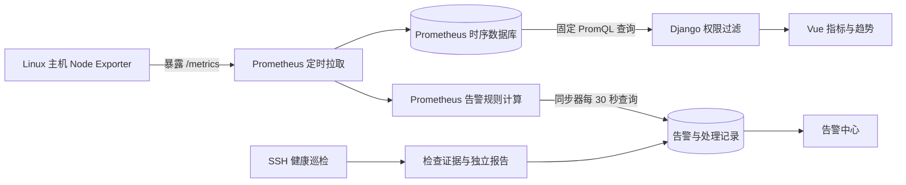

# OpsPilot-AI 主机监控与健康巡检

## 定位

健康巡检用于检查一批授权机器在当前采样时段的健康情况，适用于日常运维、重要保障和向用户提供检查报告。它可以独立使用，不是验收流程的一环。报告只说明所列检查项的结果，不承诺整台机器或未来时刻绝对正常。

持续监控用于观察指标变化并发现持续异常。告警中心汇总持续监控、巡检和外部事件。任务中心保留巡检和命令记录。本轮不实现邮件、短信、Webhook 推送等通知，不部署 Alertmanager。

## 原理：谁采集、谁存储、谁判断



1. **Node Exporter** 是运行在 Linux 主机上的只读采集组件，从内核和系统接口读取指标，通过 HTTP `/metrics` 暴露。它不向平台主动上传，不保存历史，也不接收平台的重启、脚本或 SSH 执行命令。
2. **Prometheus** 按配置主动访问 Exporter，给每个样本写入时间与标签，保存时间序列。当前使用稳定的 `host_id` 标签关联 CMDB；不使用 IP 作为唯一资产身份。
3. **指标查询** 由 Django 向固定的 Prometheus 服务发起。浏览器不直接访问采集端点，不提交任意 PromQL 或上游 URL。后端按照用户资产权限生成主机标签选择器，限制查询时段、响应大小、超时和图表点数。
4. **规则计算** 在 Prometheus 中执行。超过阈值并持续满足 `for` 后才触发；`keep_firing_for` 用于恢复保持。OpsPilot 的同步器拉取规则状态并记录告警，不另做一套相互冲突的阈值计算器。
5. **告警同步器** 独立于批量作业执行器。较长的 SSH 作业不会阻塞告警同步；规则计算也不依赖浏览器是否打开。

官方资料：

- [Node Exporter 工作与安装方式](https://prometheus.io/docs/guides/node-exporter/)
- [Prometheus 采集、文件发现和规则配置](https://prometheus.io/docs/prometheus/latest/configuration/configuration/)
- [Prometheus HTTP 查询 API](https://prometheus.io/docs/prometheus/latest/querying/api/)
- [Prometheus 告警规则](https://prometheus.io/docs/prometheus/latest/configuration/alerting_rules/)

## 本次真实测试拓扑


Exporter 的 9100 端口只监听云主机本机，没有开放安全组或公网防火墙端口。隧道严格验证已有可信 SSH 主机公钥，只允许转发到远端 `127.0.0.1:9100`，本地入口也只绑定回环地址。此次测试沿用资产已有 SSH 凭据，未创建或暴露新的 SSH 私钥。

这是本地联调方案，不是数百台资产的生产网络架构。后续生产环境宜让 Prometheus 经受控内网访问 Exporter，并按需要配置 TLS/认证和来源限制；不应为每台机器长期维护一个独立的本地测试隧道。若只能出网，应重新设计采集网络或代理路径，而不是开放无认证公网端点。

当前 Prometheus 是完整服务端，不是只有转发功能的 Prometheus Agent mode。

## 采集与指标解释

| 指标 | 含义和边界 |
| --- | --- |
| CPU | 对 idle 计数器计算 2 分钟速率，得出平均忙碌比例；首次需要至少两个样本 |
| 内存 | `1 - MemAvailable / MemTotal`；不直接把缓存等同于不可用内存 |
| 文件系统 | 使用 `avail / size`，展示使用率最高的有效文件系统；排除常见临时/伪文件系统 |
| inode | 展示最高 inode 使用率；无有效样本显示缺失 |
| 负载 | 一分钟 load average，不等于 CPU 百分比；规则阈值需结合核数设置 |
| 网络 | 非 loopback 网卡接收/发送计数器的速率，单位 B/s，当前按主机求和 |
| 采集可用性 | `up=1` 说明本次 scrape 成功；`up=0` 不代表服务器关机，也可能是网络、服务或权限故障 |
| 采集器健康 | 单项 collector 失败可单独告警；`/metrics` 可访问不代表每个 collector 成功 |

缺失、非有限数值或过期样本不能当作 0 或健康。瞬时状态与 SSH TCP 可达状态分开显示，采集失联不会直接覆盖 CMDB 为“服务器离线”。

## 告警闭环

沿用现有 Finding 表，扩展来源、故障状态、重复触发次数、恢复时间和维护标记，不建立第二套重复异常表。

- 来源：持续监控、健康巡检、外部告警。
- 故障状态：触发中、已恢复、数据未知。
- 人工处理状态：待确认、已确认、处理中、已关闭。
- 同一主机与同一监控规则使用稳定去重键。持续异常更新原记录，恢复后再次触发累计次数并重新打开。
- 手动关闭不改变故障状态。监控恢复不自动抹去人工处理过程。
- Prometheus 不可用、规则计算异常、目标停用或所需指标缺失时，不将旧告警判为恢复。资源告警在采集失联时转为数据未知；独立的采集失联规则反映连接问题。
- 维护标记有到期时间并记录操作人，本轮仅作为站内维护信息，不声称实现了通知静默、路由或消息重试。
- 普通用户按资产授权查看监控告警；个人巡检记录继续保留原用户隔离。规则及采集目标只允许管理员配置。

默认规则：采集端点失联 2 分钟、CPU 超过 90% 持续 5 分钟、内存超过 90% 持续 5 分钟、文件系统使用率超过 85% 持续 5 分钟、inode 超过 85% 持续 5 分钟、采集器失败持续 5 分钟。默认恢复保持 2 分钟。阈值是初始设置，应结合业务调整。

规则修改由同步器约 30 秒内写入配置并请求 Prometheus reload。页面显示配置应用错误，不能把“已保存数据库”当作“规则已生效”。禁用规则不删除历史告警；此前仍在触发而无法验证的告警保留未知状态供人工复核。

## 巡检与报告

健康巡检保留 SSH 按需执行，与持续监控独立。资源健康方案检查系统、CPU 短采样、内存、磁盘和负载；安全基线方案额外取证账号、SSH 策略、权限、时间同步和补丁缓存；综合方案可追加服务和证书。

报告包含标题、用途、接收方、目标主机数、实际返回数、起止时间、每台主机结论、检查说明和原始证据。失败、未返回、权限不足和需复核项会阻止报告得出“全部检查范围内未发现异常”。版本取证不直接证明不存在漏洞。

任务中心可导出独立 HTML 报告，用浏览器打开打印或另存 PDF；现有 CSV API 保留。HTML 不依赖外部资源、不包含脚本，对资产名称和证据自动转义。报告是当前权限下导出的快照，外发前应复核业务或网络信息。

历史对比只比较相同资产集合和检查方案的前次任务，突出结论变化。新增或缺失检查项明确标注，不把“本次没有检查”当作恢复。不把 CPU 数值波动宣称为配置变更。

## 资源与规模控制

- 采集周期 60 秒，规则计算 30 秒，平台同步 30 秒，列表页面刷新 30 秒；切换到后台标签页暂停页面刷新。
- 开启 cpu、meminfo、filesystem、loadavg、netdev、stat、uname、time，避免无需求开启所有 collector。
- 单目标采样上限 10000；趋势最长查询 7 天、单曲线约 360 个点；即时查询缓存 10 秒。
- Prometheus 保留 7 天、TSDB 保留大小配置 512 MB。WAL、head block、临时文件等不全计入保留大小，此项不是磁盘硬配额，仍需监测实际容量。
- Prometheus Go 运行时设置 `GOMEMLIMIT=192MiB`、`GOMAXPROCS=2`。前者是软内存目标，不是进程内存硬上限。
- Exporter 使用 DynamicUser、只读系统保护、NoNewPrivileges、96 MB 内存限制和 10% CPU 配额。不需要开放命令执行接口。
- 网络采集器需要 AF_NETLINK。真实联调中发现限制该地址族会导致 netdev 失败，已在此服务的白名单中允许；没有提升为 root 运行。
- Django 保存告警和审计，不把原始高频时序逐条写入 SQLite。监控页展示上限 300 台，与当前批量任务规模一致。
- 不增加 Redis、Celery、Grafana、日志全文索引或自研通用 Agent。本机监控新增 Prometheus、一个同步器和测试隧道进程；正式内网部署不需要测试隧道。

## 本地启动与文件

下载脚本固定本次验证版本：Node Exporter 1.12.1、Prometheus 3.15.1。来源为官方 GitHub release，并核对官方 `sha256sums.txt`；升级应重新验证版本及规则兼容性。

```powershell
.\.venv\Scripts\python.exe scripts/fetch-monitoring.py
# 如当前网络确需代理，可显式增加 --proxy http://127.0.0.1:<代理端口>
.\scripts\start-local.ps1
```

已有 `.runtime/monitor-test.json` 时，本地启动脚本一并启动监控测试服务。也可单独运行 `scripts/start-monitoring.ps1` / `scripts/stop-monitoring.ps1`。现有运行状态下不要重复启动。停止本地监控不会停止远端 Exporter。

运行目录 `.runtime/`、Prometheus 数据、下载文件、目标地址、PID 记录和日志均被 Git 忽略。代码及示例文档不包含真实私钥、密码或 Token。

- `PROMETHEUS_URL`：操作人员配置的固定查询地址，默认本机 9090。
- `MONITOR_CONFIG_DIR`：生成配置目录，默认项目 `.runtime/prometheus`。
- 配置文件：`prometheus.yml`、`rules.yml`、`targets.json`。内容使用 JSON（YAML 的子集），由服务生成，避免用户输入拼接 YAML。
- 后端：`monitoring/overview`、`hosts/<id>/history`、`hosts/<id>/workbench`、`targets/<id>`、`rules`、`health`。
- 报告：`mtask/tasks/<id>/health-report`、`comparison`，只允许访问有权查看的任务。

## 远端部署范围与回退

本次只向明确授权的测试资产安装 `/opt/opspilot-node-exporter/node_exporter` 与 `/etc/systemd/system/opspilot-node-exporter.service`，并启用该服务。部署前检查系统架构、端口占用和路径冲突，已有同名服务或目录时拒绝覆盖。未更改 SSH 配置、安全组或业务服务。

如需停止远端采集，可由管理员执行：

```sh
sudo systemctl disable --now opspilot-node-exporter.service
```

回退后同步停用平台对应采集目标，避免留下无意义的失联告警。卸载文件、删除历史监控数据或迁移生产网络应单独规划；脚本不会自动删除已有系统文件或业务数据。

## 验证边界

本轮既有模拟测试，也有授权云主机真实采集与 Prometheus 规则联调。真实告警测试临时将测试规则阈值设为可触发条件，再恢复阈值，验证触发、去重及恢复，不使用压满 CPU、填磁盘或关闭业务服务的方式制造故障。测试规则与告警在 finally 中清理。

真实验证仅覆盖当前单台 Alibaba Cloud Linux 3 主机，不能据此宣称完成几百台容量验证。资源占用是当时观测值，后续应测量更多目标、长时间保留及集中查询时的实际负载。跨网段网络设计、自动化批量 Agent 安装、服务高可用和通知均不属于本轮已验证范围。


### 本轮验证记录（2026-10-23）

- 后端 59 项测试通过，数据库迁移一致性检查通过。
- 前端生产构建通过，保留现有组件包体积警告；浏览器验证监控趋势、统一告警、主机工作台、报告、计划、模板和会话文本入口，无页面脚本错误。
- 单台真实主机全部启用 collector 成功，取得 CPU、内存、磁盘、inode、负载、网络速率与启动时长；本次 Prometheus 观测约 174 条活跃序列。
- 真实临时规则触发、去重、恢复同步通过，临时规则与告警均已清理。
- 完成一次真实只读资源健康巡检，CPU、内存、磁盘、负载通过，系统版本作为信息证据保存；样例报告保留在本地忽略目录，未上传仓库。
- 当时观测 Exporter 内存约 7～10 MB，本地 Windows Prometheus 工作集约 69 MiB。不是长期峰值或数百台规模容量结果。
- 当前项目仍保留历史无时区数据库时间。容器化或跨时区部署前，需要专门处理历史时间迁移与展示语义，不应直接切换设置后重新解释历史数据。
